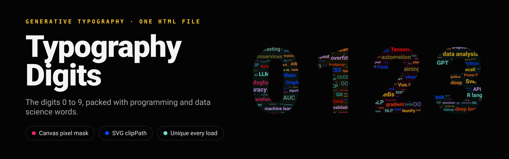
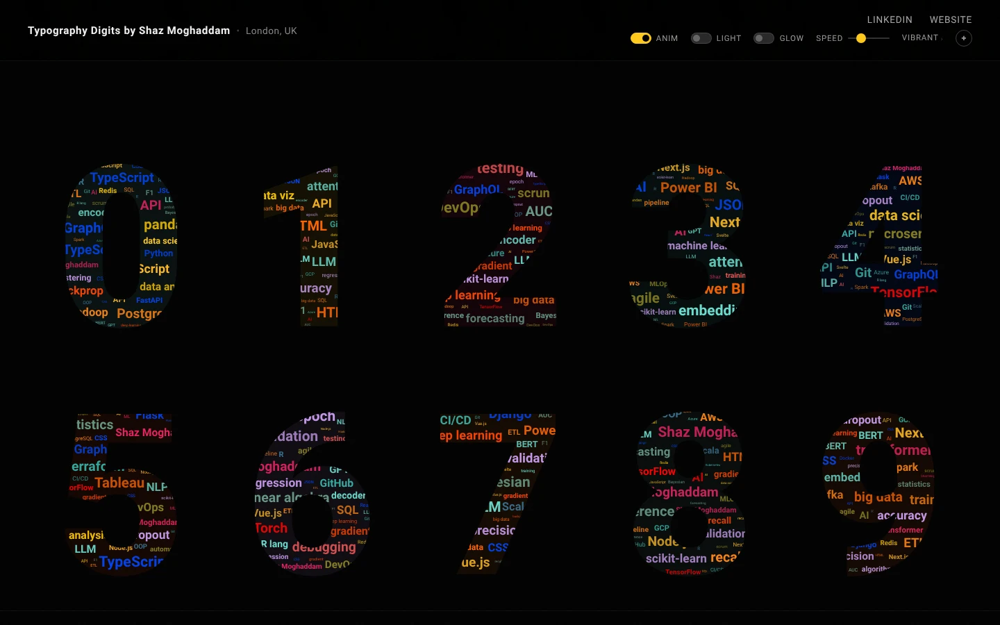
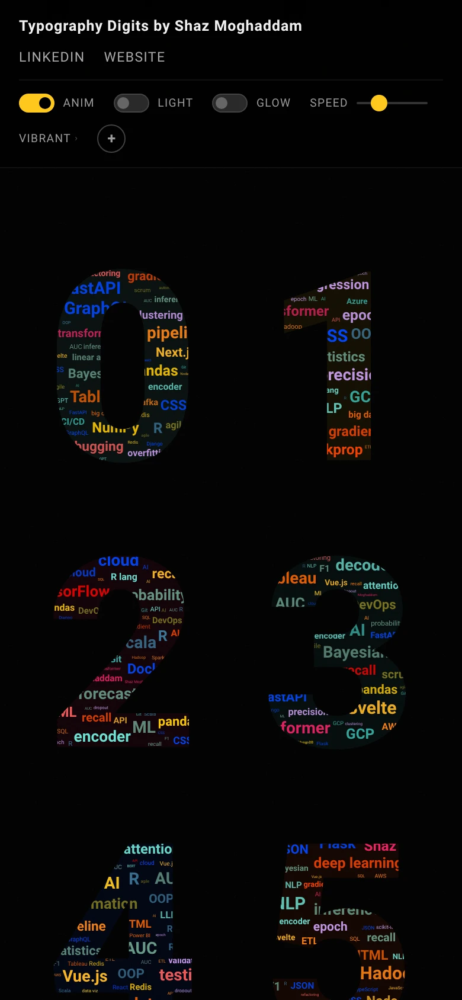
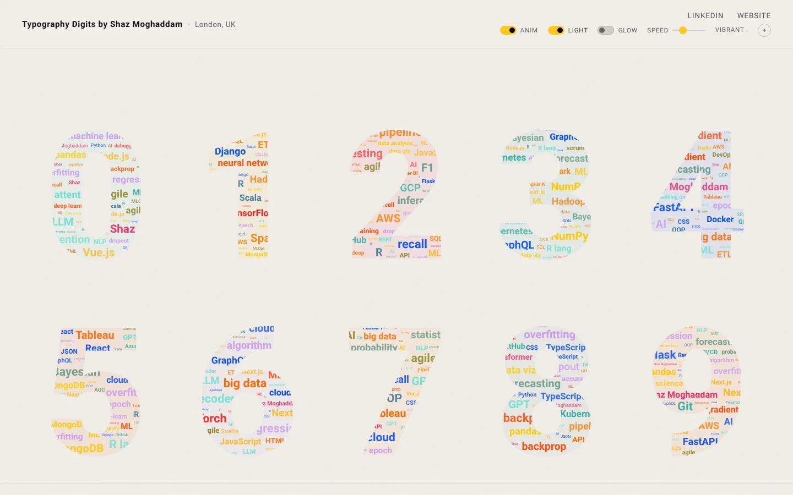

<p align="center">
  <a href="https://shazmoghaddam.github.io/typography-digits/">
    
  </a>
</p>

# Typography Digits

[](https://github.com/ShazMoghaddam/typography-digits/actions/workflows/ci.yml)
[](LICENSE)
[](CHANGELOG.md)
[](https://shazmoghaddam.github.io/typography-digits/)


The digits 0 to 9, each packed with programming and data science words. The layout is generated fresh on every load, by hand-written code in a single HTML file with no libraries.

**[Open the live demo →](https://shazmoghaddam.github.io/typography-digits/)**

**Contents:** [Features](#features) · [Screenshots](#screenshots) · [How it works](#how-it-works) · [Design decisions](#design-decisions) · [Colour system](#colour-system) · [Customise it](#customise-it) · [Accessibility](#accessibility) · [Run it](#run-it) · [Layout](#layout)

## Features

| Feature | What it does |
|---|---|
| **Generative layout** | A pixel mask plus collision checks pack about 40 words into each digit, differently every time |
| **Breathing words** | Each word fades on its own 4 to 9 second cycle |
| **Shimmer** | A diagonal gleam sweeps across each digit at a different moment |
| **3D tilt** | Digits lean towards your mouse |
| **Click / double-click** | One click lights a digit up. A double-click (or double-tap, or Enter) reshuffles it |
| **Your own words** | Press **+**, type a word and every digit is rebuilt with it |
| **Glow, speed, palettes** | Neon glow, a 0.3× to 3× speed slider, and Vibrant, Cool and Warm palettes |
| **Light mode** | A warm off-white canvas |
| **Remembers you** | Light mode, glow, animation and palette are saved for next time |

## Screenshots

<table>
  <tr>
    <td width="66%"></td>
    <td width="34%" rowspan="2"></td>
  </tr>
  <tr>
    <td></td>
  </tr>
</table>

## How it works

### 1. A pixel mask of each digit

Each digit is drawn in white on black onto an off-screen `<canvas>`, in Roboto Black at 384 px. The pixels give a map of what is inside the digit.

### 2. Words placed in four size tiers

Large anchor words go first, then medium, small and tiny ones fill the gaps. Each tier tries hundreds of random positions, and a position is only accepted if it passes **two gates**:

- **Gate A (hard):** the centre of the word's box must be inside the digit.
- **Gate B (soft):** at least half of a 6 × 6 grid of points across the box must be inside. This lets words hang over the edge and trace the digit's outline.

A bounding-box check with 1.5 px of padding stops words from overlapping.

### 3. Clipped to a perfect edge

Accepted words become SVG `<text>` inside a `<clipPath>` made from the digit itself. Words that hang over the edge are trimmed cleanly, and the result stays sharp at any size.

### 4. Fonts that match exactly

The mask, the word widths and the clip all have to use the same font, or words land in the wrong places. Roboto (400, 700 and 900) is embedded in the page and loaded explicitly before anything is measured. That way the measurements always match what you see, even offline or opened straight from disk.

### 5. Fast

Each word is measured once per weight and then scaled, because text width grows in a straight line with font size. All ten digits lay out in about 60 ms.

## Design decisions

**Why SVG `clipPath` instead of drawing on the canvas?**  
SVG stays sharp at any screen density. The canvas is only used to build the mask.

**Why vanilla JavaScript?**  
No build step, no dependencies, nothing to download. One file you can open anywhere.

**Why embed the fonts?**  
It keeps the project to one file, makes no third-party requests (better for privacy), works offline, and guarantees that the exact weight being measured is the one on screen.

**Why 16 colours?**  
Each one stands for a field: crimson for identity, blue for Python and cloud, vermillion for deep learning, aqua for NLP and LLMs, and so on. That's consistent enough to feel designed and varied enough to stay lively.

## Colour system

| Class | Hex | Used for |
|---|---|---|
| `.w-crimson` | `#EA2264` | Identity, transformers |
| `.w-gold` | `#FFC81E` | Data science |
| `.w-lavender` | `#CB9DF0` | ML and algorithms |
| `.w-blue` | `#0046FF` | Python, cloud, Docker |
| `.w-amber` | `#FFB823` | JavaScript, app development |
| `.w-vermillion` | `#FF4400` | Deep learning |
| `.w-orange` | `#FA8112` | SQL, AWS, pipelines |
| `.w-aqua` | `#6DE1D2` | NLP, GPT, LLMs |
| `.w-teal` | `#36ADA3` | Kubernetes, CI/CD |
| `.w-red` | `#FF0000` | PyTorch, TensorFlow |
| `.w-coral` | `#FA5C5C` | Debugging, testing |
| `.w-sage` | `#6A9C89` | Statistics, maths |
| `.w-olive` | `#898121` | DevOps, MLOps |
| `.w-tangerine` | `#FF6500` | HTML, big data |
| `.w-gold-deep` | `#FFC900` | Data analysis, pandas |
| `.w-slate` | `#3B7597` | General |

The Cool and Warm palettes swap these CSS variables, and the words fade smoothly between them.

## Customise it

Everything is in the CONFIGURATION block at the top of the `<script>`:

- **`WORDS`**: the vocabulary. Add your own skills or name.
- **`COLOUR_RULES`**: which word gets which colour. The first match wins.
- **`TIERS`**: font sizes, word counts and attempts for each size tier.
- **`DIGIT_TINTS`**: the faint background colour of each digit.
- **`:root` CSS variables**: all 16 colours in one place.

## Accessibility

- Every control works with a keyboard and shows a clear focus ring. The toggles are announced as switches.
- Digits can be focused with Tab, and **Enter** or **Space** reshuffles them.
- Each digit has a text label for screen readers.
- `prefers-reduced-motion` turns off the entrance, breathing, shimmer and tilt animations, and the Anim toggle starts off.
- Words you add are always shown as plain text and can never run as code.

## Run it

Open `index.html` in a browser. That's it.

To run the tests or rebuild the images, you need Node 20 or later:

```bash
npm install
npx playwright install chromium
npm test                 # smoke tests at 320, 390, 768, 1024 and 1440 px
npm run build:assets     # banner, social preview and screenshots
```

## Layout

```
index.html              the whole project: markup, styles, script and embedded fonts
assets/
  banner.png            README banner
  social-preview.png    GitHub social preview (Settings > Social preview)
  screenshots/          README screenshots
  build.mjs             builds all of the above from the live page
scripts/serve.mjs       tiny static server used by the build and tests
tests/smoke.mjs         headless browser tests, run in CI
licenses/roboto.txt     licence for the embedded Roboto font (Apache 2.0)
```

## Licence

[MIT](LICENSE). The embedded Roboto font is © Google, under the [Apache License 2.0](licenses/roboto.txt).

---

Created by **Shaz Moghaddam** · London  
[Website](https://shazmoghaddam.github.io/) · [LinkedIn](https://www.linkedin.com/in/shazmoghaddam/)
